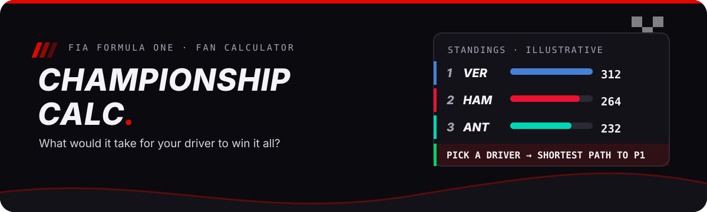

<p align="center">
  
</p>

<p align="center">
  <a href="https://github.com/kawishbit/f1-championship-calc/commits/main"></a>
  <a href="./LICENSE"></a>
  
  
  
  
  
</p>

# f1-championship-calc

**What would it take for your driver to win the F1 title?** A fan calculator that takes the current standings plus the remaining rounds and answers exactly that — for drivers and constructors.

## Try it on any contender

Pick a driver, a position and a round — say Antonelli, P1, after the United States Grand Prix — and the calculator answers what has to happen for that position to be clinched by then: Antonelli wins, Russell finishes P9 or lower, Hamilton P5 or lower. The scenario builder then lets you assign those finishes round by round and watch the projected table move, including head-to-head finishes.

## What it does

- **Standings** — drivers and constructors from the latest snapshot, with team-colour rows.
- **Points still available** — GP / sprint / fastest-lap boxes for the undecided rounds.
- **What would it take** — what has to happen for a driver or team to clinch a position after a chosen round, or the earliest round it becomes possible.
- **Scenario builder** — assign finishing orders to the remaining rounds (bulk or per-round fine-tune) and watch the projected table move, including head-to-head finishes.
- **Clinch math** — who is mathematically certain, still alive, or eliminated on points.

## How it works

Everything comes from [OpenF1](https://openf1.org) and is read when a visitor's request misses Vercel's cache (`src/lib/load-snapshot.ts`): standings from `championship_drivers` / `championship_teams`, the calendar and sprint weekends from `meetings` / `sessions`, names and team colours from `drivers`. The rendered page is cached by Vercel (ISR) until shortly after the next Grand Prix ends, never longer than 3 days, so a quiet week costs no API calls and a race is picked up soon after its points are published. If OpenF1 cannot be read (it answers 401 during live sessions and 429 under load), the page serves the committed `src/data/snapshot.json` with a short cache and an out-of-date notice. Driver photos are proxied from F1's CDN through `/drivers/*` and cached for 30 days. Pure functions in `src/lib/championship.ts` do the math (`availablePoints`, `clinchAfterRound`, `projectStandings`, `clinchState`); `src/lib/snapshot.ts` turns OpenF1 responses into the data the UI renders; `src/components/Calculator.astro` renders the Astro UI. See ADR-0004.

Glossary: **standings** (points table) · **scenario** (your assigned finishes for remaining rounds) · **clinch** (mathematically certain to finish at a position or better, regardless of other outcomes) · **round** (one Grand Prix weekend, optionally with a sprint; cancelled weekends don't count) · **played round** (a round whose result is already in the standings).

## Run it

```bash
pnpm install
pnpm dev        # local app
pnpm snapshot   # refresh the committed fallback, src/data/snapshot.json
pnpm test       # championship, clinch and OpenF1 transform tests
pnpm build
```

## Limits

Unofficial fan project, not affiliated with Formula 1. A points tie counts as clinched only when the rival can't match the contender's wins even by winning every remaining Grand Prix; deeper countback is ignored. Driver photos via the F1 CDN, found through OpenF1.

## License

MIT — see [LICENSE](./LICENSE).
